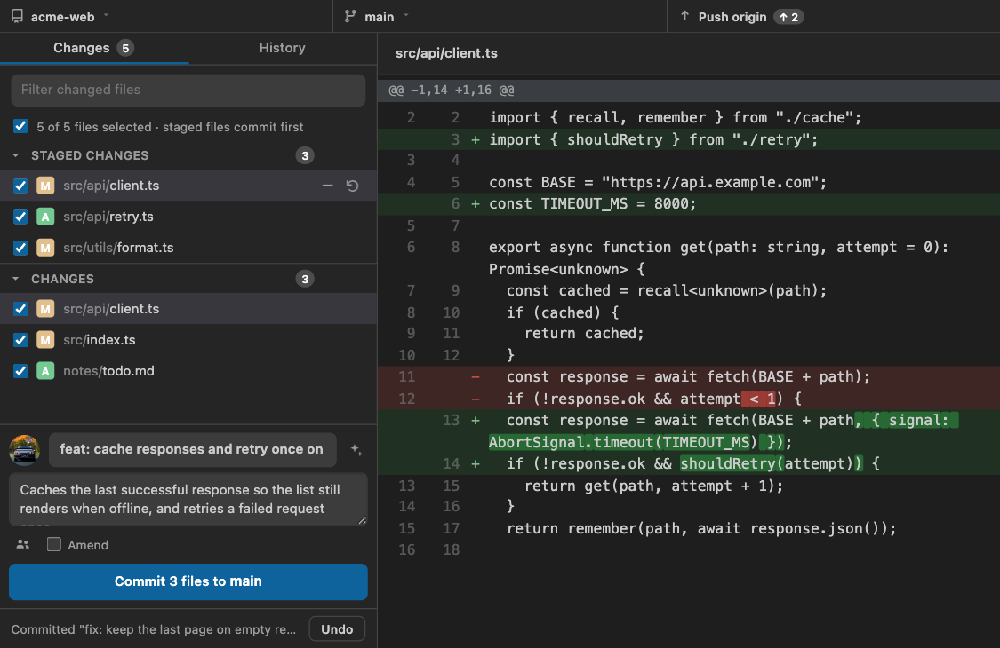
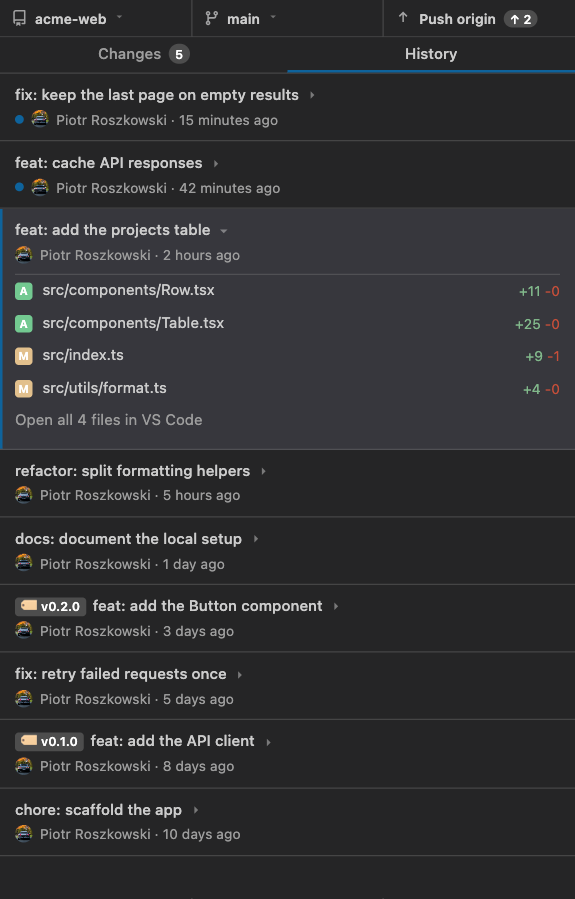
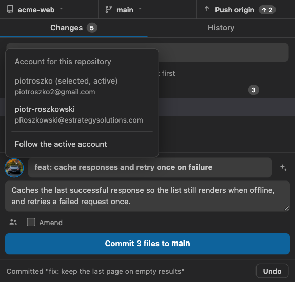

# GitHub Desktop Plus

<p align="center">
  
</p>

GitHub Desktop's workflow inside VS Code: staged and unstaged changes side by
side, a commit box, branch and sync controls, a visual history, conflict handling
and multiple GitHub accounts.

## A fork of vscode-github-desktop

This extension continues
[`vscode-github-desktop`](https://github.com/betaversionio/github-desktop) by
Satyam Lohiya, published on the Marketplace as *GitHub Desktop*, and is
maintained here as **GitHub Desktop Plus**. It is a separate extension with its
own id, so it installs alongside the original.

On top of the original it adds:

- per-repository GitHub accounts, including the identity commits are authored as
- a per-repository comparison branch, independent of git's upstream
- expanding a commit in History to the files it touched
- drafting a commit message from the diff through a CLI
- a rebrand (name, icon, command prefix) so both extensions can coexist

## Screenshots

### Changes and the commit box


### History, with a commit expanded


### Choosing the account a repository commits as


## Features

### Changes and commits
- Staged and unstaged sections, one row per file per side, with per-file stage,
  unstage and discard; a file that is staged and then edited again appears in both
- Commit box with summary, description, co-authors, Amend and the number of files
  it will commit. Anything staged is committed from the index; with nothing
  staged, the ticked files are committed together
- The message, description, co-authors and ticked files are kept per repository,
  so a draft survives hiding the view, reloading the window or switching
  repository
- Generate a conventional-commit message from the diff with a command of your
  choice, such as an agent CLI
- Undo the last commit (leaving its changes staged), amend it, or force-push after
  rewriting history
- A merge, cherry-pick, revert or rebase stopped in conflict is shown in the
  panel, where files can be marked resolved and the operation continued or aborted
- The panel refreshes on save, on focus, and every 30 seconds while visible, so
  changes made in a terminal appear without reopening the view
- The activity-bar icon badges how many files have uncommitted changes

### History
- Commit list with author avatars, relative times, tag badges and unpushed markers
- Expand a commit to see the files it touched with per-file line counts, or open
  all of them in VS Code's own changes editor
- Right-click a commit to reset, check out, revert, cherry-pick, create a branch
  or a tag, copy its SHA, or open it on GitHub
- Diffs render in the panel's own pane, and fall back to VS Code's diff editor
  when the panel is too narrow to show one. `githubDesktopPlus.diff.view` decides
  that: `panel` keeps them in the pane, `editor` sends every diff to VS Code

### Branches, sync and pull requests
- Branch menu grouped into default, recent and other, with last-commit activity
- Create, switch and merge branches, and compare one branch against another
- Per-repository base branch: compare against `develop` even when the branch
  tracks `prod`. Sync state and pull-request links follow it, while push and pull
  keep using git's own upstream
- Fetch, pull, push, publish and force-push, with ahead/behind counters
- Open pull requests for the branch are listed and can be checked out locally
- Stash the working tree, or have it stashed when switching to another branch, and
  apply or drop stashes from the list

### Accounts
- Several GitHub accounts at once, signed in through VS Code's browser flow, the
  GitHub CLI (every account `gh` knows about is imported), a personal access
  token, or GitHub Enterprise Server
- Tokens are stored in VS Code's Secret Storage
- Pin a repository to an account from the Repositories tree, the Accounts tree or
  the avatar beside the commit summary. Unassigned repositories follow the active
  account, and a pin whose account has been signed out falls back to it
- The selected account is also the commit identity: commits, amends, cherry-picks,
  reverts, merges, conflict continuations, pulls and annotated tags run with that
  account's name and email — its public profile address, or GitHub's
  `<id>+<login>@users.noreply.github.com` no-reply address — rather than the
  machine's global git config. Nothing is written to `.git/config`

### Repositories
- Repositories are detected from the workspace; others can be cloned or added by
  path
- Switching repository keeps the current VS Code window and is remembered for the
  session
- Create an issue, or open the repository, a commit or a pull request on GitHub

## Installation

Install **GitHub Desktop Plus** from the VS Code Marketplace, or from a `.vsix`:

```bash
code --install-extension github-desktop-plus-<version>.vsix
```

## Getting started

1. Open the extension in the activity bar and choose *Sign In*, or run
   `GitHub Desktop Plus: Sign In` from the Command Palette.
2. Pick a sign-in method: VS Code's browser flow (recommended), the GitHub CLI, a
   personal access token, or a GitHub Enterprise Server URL.
3. Open any Git repository in your workspace — it is detected automatically. Use
   the Repositories view, or `Clone Repository`, for anything else.
4. Stage files, write a message and commit. Branch, sync and history controls sit
   in the same panel.

If you sign in with a personal access token, it needs the `repo`, `read:org` and
`user:email` scopes.

## Commands

All commands are available from the Command Palette (`Ctrl+Shift+P` / `Cmd+Shift+P`):

| Command | Purpose |
| --- | --- |
| `GitHub Desktop Plus: Sign In` | Add a GitHub account |
| `GitHub Desktop Plus: Sign Out` | Remove an account |
| `GitHub Desktop Plus: Manage GitHub Accounts` | List, switch and remove accounts |
| `GitHub Desktop Plus: Switch Active Account` | Change the account unassigned repositories use |
| `GitHub Desktop Plus: Clone Repository` | Clone with an account and progress reporting |
| `GitHub Desktop Plus: Open Repository` | Switch the tracked repository |
| `GitHub Desktop Plus: Select Account for Repository` | Pin one repository to an account |
| `GitHub Desktop Plus: Use Account for Current Repository` | Apply an account to the repository you are working on |
| `GitHub Desktop Plus: Select Base Branch for Repository` | Choose the branch to compare against |
| `GitHub Desktop Plus: Create Issue` | Open a new issue for the repository |
| `GitHub Desktop Plus: Refresh Views` | Re-read the repositories and their state |

The Accounts and Repositories views also offer these as context-menu entries.

## Settings

The Settings UI groups these into categories — **GitHub Desktop Plus**, **Git**,
**Diff**, **History**, **Interface** and **Confirmations** — matching the order
below.

| Setting | Default | Purpose |
| --- | --- | --- |
| `githubDesktopPlus.commitMessageCommand` | `omp` | Command behind the Generate button. It receives the diff on stdin and prints the message on stdout |
| `githubDesktopPlus.commitMessageArgs` | `["-p", "--model", "commit"]` | Arguments passed to that command, before the built-in prompt |
| `githubDesktopPlus.git.path` | `""` | Executable used for every git command. Empty uses the `git` on `PATH` |
| `githubDesktopPlus.git.defaultRemote` | `origin` | Remote used by operations that name one: publishing, pushing a branch for the first time, force-push, tag push, checking out a pull request, and reading a repository's metadata |
| `githubDesktopPlus.diff.view` | `auto` | Where diffs are shown. `auto` uses the panel's own pane when there is room and VS Code's diff editor otherwise; `panel` always uses the pane; `editor` never does — a changed file, a commit or a file inside a commit opens in VS Code's diff editor |
| `githubDesktopPlus.diff.contextLines` | `3` | Lines of unchanged context around each hunk, in working-tree and commit diffs. `0` shows only the changed lines |
| `githubDesktopPlus.stash.includeUntracked` | `true` | Save untracked files with the stash instead of leaving them in the working tree |
| `githubDesktopPlus.history.pageSize` | `50` | Commits per page in the History list, for the first page and every *load more* |
| `githubDesktopPlus.history.dateFormat` | `relative` | `relative` shows "3 days ago", `absolute` shows the recorded time, e.g. `2026-10-12 14:26` |
| `githubDesktopPlus.autoRefreshInterval` | `30` | Seconds between refreshes of the History panel while it is visible; `0` disables periodic refreshes |
| `githubDesktopPlus.ui.avatars` | `github` | `github` loads avatar images from GitHub; `none` shows theme icons and initials instead and makes no avatar requests |
| `githubDesktopPlus.ui.activityBarBadge` | `true` | Show the number of pending changes on the activity-bar icon |
| `githubDesktopPlus.confirm.destructiveActions` | `true` | Ask before discarding changes, undoing a commit, amending a pushed commit, resetting, force-pushing, dropping a stash or merging into the default branch. `false` performs them immediately |

## Requirements

- VS Code 1.84.0 or newer
- Git installed and available on `PATH`, or set `githubDesktopPlus.git.path` to
  its absolute location
- A GitHub account for the GitHub-specific features; local git operations work
  without one

## Security and privacy

- GitHub tokens are stored with VS Code's Secret Storage (the OS keychain), never
  in `settings.json` or `.git/config`
- Credentials for network operations are passed per git invocation as an ephemeral
  `http.extraheader`; repository configuration is left untouched
- Everything runs locally. The extension collects no telemetry and sends nothing
  anywhere except the GitHub API calls its features require — setting
  `githubDesktopPlus.ui.avatars` to `none` removes the avatar lookups entirely
- Commands run through `execFile` with argument arrays rather than a shell

## Issues and contributions

Bug reports and pull requests are welcome in
[the repository](https://github.com/piotroszko/github-desktop-plus/issues).

## License

MIT. Copyright (c) 2025 Satyam Lohiya, author of the original
`vscode-github-desktop`, and (c) 2026 Piotr Roszkowski for the changes in this
fork. Both notices are retained in [LICENSE](LICENSE).
